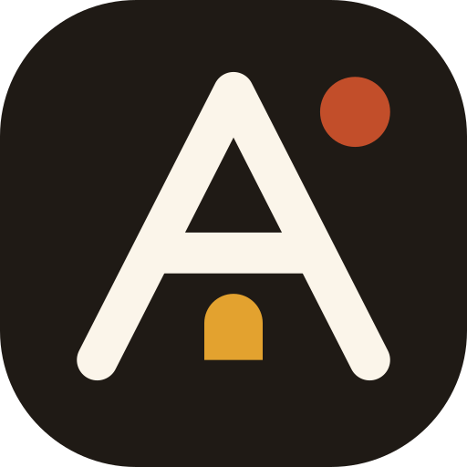

<p align="center"></p>
<h1 align="center">Afroicons</h1>
<p align="center"><b>Des icônes libres qui racontent l'Afrique.</b><br>162 icônes culturelles, au trait et remplies, + 163 icônes d'interface · grille 24 px · FR / EN · open source (MIT)</p>
<p align="center"><a href="https://afroicons.org"><b>afroicons.org</b></a></p>
<p align="center">
  <a href="LICENSE"></a>
  <a href="https://github.com/cybexai/afroicons/actions/workflows/ci.yml"></a>
  <a href="CONTRIBUTING.md"></a>
</p>

---

🇫🇷 **Afroicons** est une bibliothèque d'icônes dessinées à la main pour les produits africains : nos paysages, notre faune, nos instruments, nos symboles, nos plats et notre quotidien — de la moto-taxi à la tontine, de la case obus au mobile money.

🇬🇧 **Afroicons** is a hand-drawn icon library for African products: landscapes, wildlife, instruments, symbols, food and everyday life — from the moto-taxi to the tontine, from the Musgum hut to mobile money.

## Paquets · Packages

| Paquet | Usage |
| --- | --- |
| [`afroicons`](packages/afroicons) | SVG, sprite, `icons.json`, fonction `toSvg()` (JS natif) |
| [`afroicons-react`](packages/afroicons-react) | Un composant React par icône |
| [`afroicons-ui`](packages/afroicons-ui) | 163 icônes d'interface, compatibles `lucide-react` (mêmes noms, mêmes props) |
| [`afroicons-angular`](packages/afroicons-angular) | Composant Angular autonome `<afroicon>`, toutes les icônes |

## Démarrage rapide · Quick start

```bash
npm install afroicons          # SVG + JS
npm install afroicons-react    # React
npm install afroicons-angular  # Angular
```

### React

```jsx
import { Baobab, Djembe, Mototaxi } from "afroicons-react";

<Baobab />
<Djembe size={32} color="#C24E2A" />
<Mototaxi strokeWidth={2} title="Livraison en benskin" />
```

### JavaScript

```js
import { toSvg, replace } from "afroicons";

document.querySelector("#btn").innerHTML = toSvg("mobilemoney", { size: 20 });

// ou : <i data-afroicon="baobab" data-size="32"></i> dans le HTML, puis
replace();
```

### HTML (sprite)

```html
<!-- collez une fois node_modules/afroicons/sprite.svg dans la page -->
<svg width="24" height="24"><use href="#afroicon-kora"/></svg>
```

### Fichiers SVG

`node_modules/afroicons/svg/<id>.svg` — une icône par fichier, couleur `currentColor`.

## Les icônes

| Catégorie | Nombre | Exemples |
| --- | ---: | --- |
| Nature & paysages | 18 | baobab, kilimandjaro, harmattan, volcan |
| Faune | 24 | éléphant, okapi, pangolin, caméléon, calao |
| Musique & arts | 18 | djembé, kora, balafon, sanza, kanaga |
| Symboles & textiles | 16 | sankofa, adinkrahene, wax, kente, bogolan |
| Cuisine | 26 | foufou, plantain, safou, kola, jebena |
| Vie quotidienne | 34 | moto-taxi, keke, mobile money, tontine, gele |
| Architecture | 14 | Djenné, case obus, Lalibela, Grand Zimbabwe |

Chaque icône porte un nom français et anglais, une catégorie, une région (`ouest`, `centre`, `est`, `nord`, `australe`, `pan`) et des mots-clés locaux (benskin, okada, matatu, attiéké…). Tout est dans `icons.json`.

## Principes de dessin

- Grille de **24 × 24 px**, contenu dans une zone de 20 px
- Trait **1,75 px**, extrémités et angles **arrondis**
- Couleur héritée (`currentColor`), pas de remplissage sauf pour les petits points
- Lisible à **16 px**, cohérent jusqu'à 512 px
- Pas de clichés, pas de marques, pas de reproductions d'œuvres


## Développement

```bash
npm ci
npm run dev          # site React en local (http://localhost:5173)
npm test             # régénère les paquets et vérifie les icônes
npm run build:web    # compile le site pour afroicons.org (apps/web/dist)
```

Organisation du dépôt :

```
src/icons.json              ← source unique de vérité (dessins + métadonnées)
src/ui-icons.json           ← icônes d'interface (noms Lucide)
scripts/build.mjs           ← génère les paquets à partir de icons.json
packages/afroicons          ← paquet npm : SVG, sprite, toSvg()
packages/afroicons-react    ← paquet npm : composants React
packages/afroicons-ui       ← paquet npm : icônes d'interface compatibles lucide-react
packages/afroicons-angular  ← paquet npm : composant Angular (le composant est écrit à la main, les données générées)
apps/web                    ← le site afroicons.org (React + Vite + TypeScript)
  src/lib/                  ← données, SVG, recherche, motifs, i18n, boîte à idées
  src/components/           ← en-tête, bibliothèque, fiche, atelier, vitrine, marque…
  src/state.tsx             ← état global (langue, thème, ambiance, personnalisation)
```

Après le build, `apps/web/scripts/pages.mjs` génère une page HTML par icône (`/icones/<id>/`), la liste `/icones/` et `sitemap.xml`.

Le site consomme directement le paquet `afroicons` du dépôt : ajouter une icône dans `src/icons.json` la fait apparaître partout.

## Contribuer · Contributing

Afroicons est **open source** et se construit avec sa communauté. Toutes les contributions comptent, même sans savoir dessiner :

- **Proposer une icône** qui manque, depuis la [boîte à idées](https://afroicons.org/#idees) ou un [ticket](https://github.com/cybexai/afroicons/issues/new/choose)
- **Voter** avec un 👍 pour les propositions qui vous parlent
- **Partager un savoir** : nom local, signification d'un symbole, photo libre de droits
- **Dessiner** une icône, **corriger** un dessin, **améliorer** le site ou les paquets

Le [guide de contribution](CONTRIBUTING.md) explique comment dessiner et ajouter une icône. Les questions et idées ont leur place dans les [discussions](https://github.com/cybexai/afroicons/discussions). En participant, vous acceptez le [code de conduite](CODE_OF_CONDUCT.md). Pour une faille de sécurité, voir [SECURITY.md](SECURITY.md).

🇬🇧 Afroicons is open source and community-built: suggest and vote for icons, share local knowledge, draw or fix icons, or improve the site and packages. See [CONTRIBUTING.md](CONTRIBUTING.md).

## Soutien

Afroicons est un projet indépendant et communautaire, porté par THAFAM HOLDING SARL et soutenu par [NAFA ERP](https://nafaerp.com).

## Licence

[MIT](LICENSE) © 2026 THAFAM HOLDING SARL et les contributeurs d'Afroicons. Utilisation libre, y compris commerciale ; une mention est appréciée.
